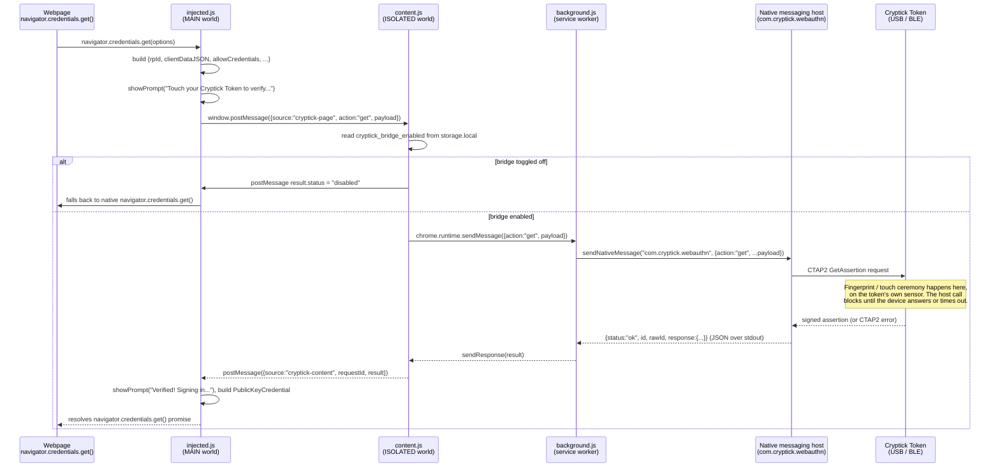

# Architecture: how a request actually moves

This document traces, hop by hop, what happens inside this repo's code when a
WebAuthn request is made — either by a webpage calling `navigator.credentials`,
or by the user managing their key from the popup. Every step below is
grounded in `injected.js`, `content.js`, `background.js`, and `popup.js` as
they exist in this repo today; nothing here is aspirational.

Two components outside this repo complete the picture and are treated as
black boxes with a known message contract:

- **Native messaging host** — a local binary registered under the native
  messaging host name `com.cryptick.webauthn` (see `HOST_NAME` in
  `background.js`). This extension only ever talks to it via
  `chrome.runtime.sendNativeMessage`; it has no other way to reach hardware.
- **The physical Cryptick Token** — reached by the host directly over USB, or
  over Bluetooth via a separate background bridging daemon the host talks to.
  Either way, this extension never sees that distinction: it only sees the
  host's JSON response.

## Components in this repo

| Component | Context | Role |
|---|---|---|
| `injected.js` | Page **MAIN** world (`manifest.json`: `"world": "MAIN"`) | Overrides `navigator.credentials.create`/`get`. Builds the WebAuthn request payload, shows/hides the in-page "Touch your Cryptick Token to verify…" prompt, and turns the host's response back into a `PublicKeyCredential`. |
| `content.js` | Page **ISOLATED** world | Pure relay between `injected.js` (via `window.postMessage`) and `background.js` (via `chrome.runtime.sendMessage`). Also the one place that enforces the "Use Cryptick for passkeys" on/off toggle for `create`/`get`. |
| `background.js` | Service worker | The only code in this extension that calls `chrome.runtime.sendNativeMessage`. Forwards whatever action/payload it's given; adds no logic beyond status caching (see below). |
| `popup.js` | Extension popup | Talks to `background.js` directly — it does not go through `content.js`/`injected.js`. Drives the Passkeys/Authenticator/Device tabs. |

---

## Flow 1 — a webpage signs in or registers a passkey

Triggered by a page calling `navigator.credentials.get()` (sign-in) or
`.create()` (registration). Both follow the same path; `get` is shown below.



Notes grounded in the code:

- The only gate on this whole path is the `cryptick_bridge_enabled` flag that
  `content.js` reads before forwarding `create`/`get` — this is the
  "Platform Passkey Delegation" escape hatch surfaced as the "Use Cryptick
  for passkeys" switch in `popup.js`/`popup.html`. Every other action
  (`status`, `totp_*`, `list_credentials`, …) is forwarded unconditionally.
- `background.js` adds no business logic to this path: `action === 'get'`
  (and `'create'`) is forwarded as `{ action, ...payload }` straight to
  `sendNativeMessage`, and whatever comes back is handed to `sendResponse`
  as-is.
- The touch-wait **timeout** for this flow is enforced client-side, in
  `injected.js`'s `callCryptick()`: a `setTimeout` for `payload.timeout ||
  60000` ms rejects with a `TimeoutError` if no response arrives — there is
  no polling here, just one request and one response, with the host/device
  expected to block for up to that long while the ceremony is pending.
- If the error that comes back indicates the token is offline/disconnected
  (`injected.js`'s `isDisconnected` check on the error string), the prompt is
  hidden immediately and the promise rejects so the browser's native
  WebAuthn UI can take over — the same fallback as the bridge-disabled case,
  just reached from a different signal.

---

## Flow 2 — managing saved passkeys from the popup

Triggered by opening the Passkeys tab (`loadCredentials()`) or confirming a
per-row delete (`executeDeleteCredential()`). Unlike Flow 1, this goes
straight from `popup.js` to `background.js` — no content/injected script is
involved, because the popup is already extension context.

```mermaid
sequenceDiagram
    participant Popup as popup.js<br/>(sendWithTouchWait)
    participant Background as background.js
    participant Host as Native messaging host
    participant Token as Cryptick Token

    Popup->>Popup: loadCredentials() -> sendWithTouchWait("list_credentials", null, onTouchPending)
    loop every 1.2s, up to ~48s (CRED_TOUCH_MAX_ATTEMPTS)
        Popup->>Background: chrome.runtime.sendMessage({action:"list_credentials"})
        Background->>Host: sendNativeMessage({action:"list_credentials"})
        Host->>Token: request a UV-scoped auth token<br/>(fingerprint ceremony, no PIN)
        alt ceremony still pending
            Host-->>Background: {status:"touch_required"}
            Background-->>Popup: {status:"touch_required"}
            Popup->>Popup: showCredTouchGate() -- "Touch your Cryptick Token to verify…"
            Popup->>Popup: await 1.2s, then retry the same request
        else ceremony settles (touch given, or error/timeout)
            Token-->>Host: resident credentials, or a failure
            Host-->>Background: {status:"ok", relyingParties:[...], totalCredentials, ...}<br/>or {status:"error", message}
            Background-->>Popup: terminal response
            Popup->>Popup: hideCredTouchGate(); renderCredentialGroups(...)<br/>or renderCredentialError(...)
        end
    end
```

Per-row delete follows the identical shape, just with
`sendWithTouchWait('delete_credential', { credentialId, rpId }, ...)` in
place of `list_credentials`, and a row-local "Touch to verify…" badge
(`touchPendingBadgeHtml()`) instead of the tab-level gate.

Notes grounded in the code:

- **No PIN, anywhere.** Neither request ever carries a `pin` field —
  `background.js`'s own comment on `NATIVE_ACTIONS_WITH_PAYLOAD` is explicit
  that `delete_credential` "carries no secret here — it's gated by the
  device's own fingerprint/UV ceremony … not by anything typed into this
  extension." There is no PIN input anywhere in `popup.html`.
- `sendWithTouchWait()` is deliberately tolerant of **either** a host that
  answers `touch_required` immediately and keeps answering it until the
  touch lands (the poll loop above actually repeating), **or** a host that
  just blocks on one call and returns the terminal `ok`/`error` directly
  (in which case the loop's `continue` branch is simply never taken, and the
  first response is already terminal). Both shapes satisfy the same
  `popup.js` code path — see `CRED_TOUCH_POLL_MS` / `CRED_TOUCH_MAX_ATTEMPTS`
  and the surrounding comment in `popup.js`.
- A deleted row's RP group is dropped once empty, and the touch gate/badge is
  always cleared (`hideCredTouchGate()` / `resetRowActions()`) on a terminal
  response, success or failure — the UI never gets stuck mid-ceremony.

---

## Adjacent flow — multi-device picker

`popup.js`'s `loadDevices()` calls `list_devices` the same direct way as
Flow 2, but it is **not** gated by a touch ceremony (enumerating devices
isn't a credential operation):

```
popup.js --sendMessage({action:"list_devices"})--> background.js
         --sendNativeMessage-----------------------> host --> (enumerates known/paired devices)
host --{status:"ok", devices:[{id, name, transport, active}, ...]}--> background.js --> popup.js
```

`renderDevicePicker()` only shows the `<select>` when `devices.length > 1`.
Choosing another device sends `{action:"select_device", payload:{id}}`
through the same `background.js` forwarding path; on success, `popup.js`
calls `checkStatus(true)` so the top-bar chip and the Device tab pick up the
newly active device on their next poll — there is no separate "device
switched" push message.

---

## Status polling and caching (`background.js`)

Not a WebAuthn request, but part of how every other flow gets its "is a
token even connected" context, and worth grounding since it's easy to
misread `background.js`'s module-level state as more persistent than it is:

- MV3 can kill and respawn the service worker between any two messages, so
  `cachedStatus` and `wasPreviouslyConnected` are only safe as *within-session*
  fast paths. On every cold start, `background.js` re-hydrates
  `wasPreviouslyConnected` from `cryptick_cached_status` in
  `chrome.storage.local` *before* its first `status` query, specifically so a
  worker restart while the token is already connected isn't mistaken for a
  fresh connection (which would otherwise fire a spurious `sync_time` call).
- `popup.js` mirrors this: on `DOMContentLoaded` it paints instantly from the
  cached status in storage, then calls `checkStatus(false)` for a fresh one,
  and polls every 1.5s afterward — so the popup never shows a blank/loading
  flash while a real query is in flight.
